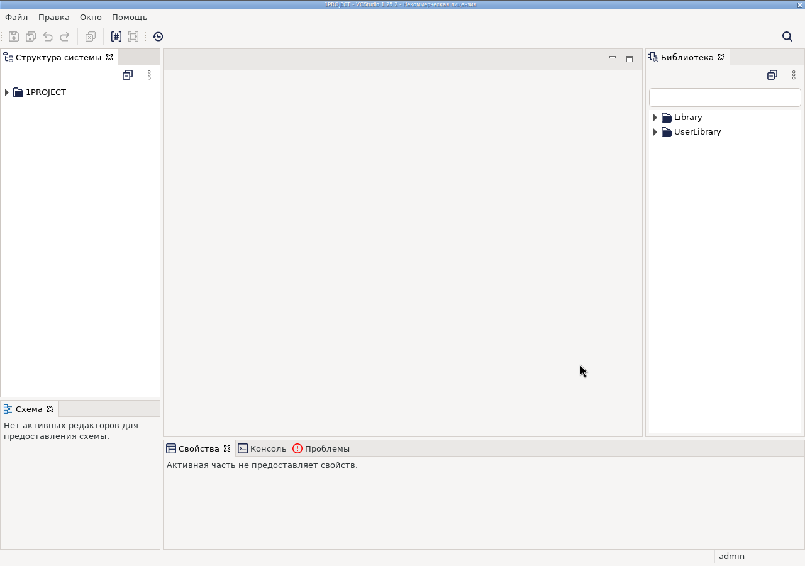
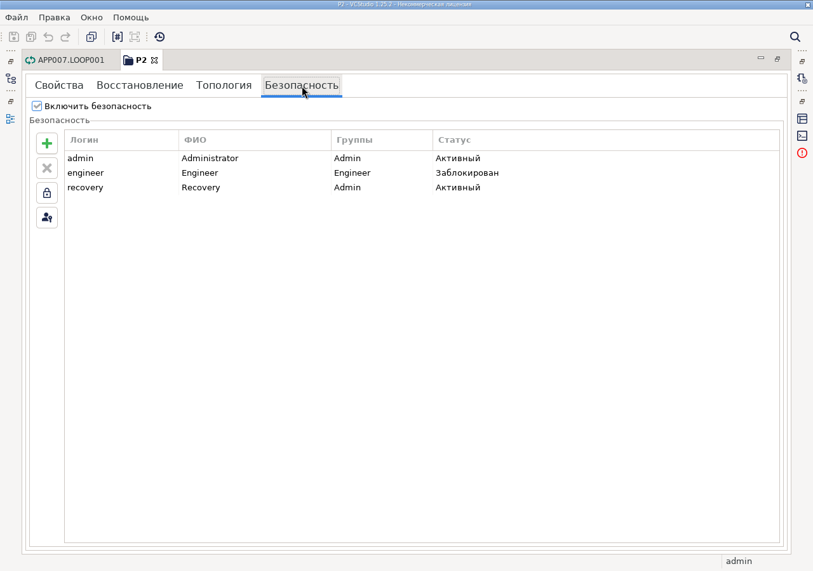

# Влияние VCONT-2027/VCONT-2127 на тесты Studio

Исторический снимок аудита и последующих правок, не текущий список падений.
Перед изменением теста проверь его нынешнее состояние. Само наличие пункта
в разделе «устаревшие ожидания» не означает, что правка ещё не выполнена: см.
раздел «Актуализация тестов после аудита» в конце этого файла.

Снимок аудита **11.11.2026**. Контракт и границы источников — в
[file-mode-security.md](../guides/file-mode-security.md), полный текст задач и комментариев —
[file-mode-security-source.md](../sources/file-mode-security-source.md). Все существенные
выводы приведены здесь; исходные `.doc` и внешний отчёт для чтения не нужны.

Область: весь локальный каталог `scenarios/`, вызываемые Python handlers/validators,
Java bridge, `tests/e2e` и относящиеся unit-тесты в `vcstudio-ui`. Исходное состояние
содержит уже согласованные незакоммиченные правки фикстур; они зафиксированы до
аудита, а не заменены состоянием HEAD. Набор сценариев и их ожидания здесь не
менялись. Remote TestOps и текущее состояние связанных задач не запрашивались.

Проверена поставленная Studio `1.25.2.202610210625`, SHA256 архива
`915b105e175bb597536a8262cc01b79e59ab616a493f5ce1d1686e75a0f7f572`.
При дальнейшем изменении тестов перепроверь пути/строки и актуальность этого снимка.
Статическое противоречие не выдаётся за результат выполнения каждого теста.

## 1. Создание проекта: 14 устаревших ожиданий в 12 сценариях

Основание: VCONT-2127, Main changes и пункт 1. Новый файл после `Создать` открывается
с автоматическим admin; обычное окно входа требуется при последующем открытии
защищённого существующего файла. В поставленном `NewFileProjectHandler.execute`
после мастера вызываются `restoreDefaultUsersContainer(path)` и
`fakeAuthenticateForFileMode("admin")`, затем открытие нового проекта.

Во всех строках ниже после конкретного клика `Создать` ожидается
`Label("Вход:").count == 1`, затем ввод admin/admin. Это **contradicted** новым
контрактом создания. ТК 1003 дополнительно выполнен: фактический count=0,
проект уже открыт; тест failed на этом ожидании. Остальные строки — статический
вывод, без индивидуального прогона.

| ТК | Шаг ожидания | Исходник теста | Различие / статус |
| --- | --- | --- | --- |
| 225 | `testops-2192-login-initial` после `testops-2192-create-initial` | `scenarios/regression_debug/0225_hierarchy_create_delete.json:216` | login → auto-admin; **contradicted, static** |
| 225 | `testops-4946-login-repopulate` после `testops-4946-create-repopulate` | `scenarios/regression_debug/0225_hierarchy_create_delete.json:2183` | login → auto-admin; **contradicted, static** |
| 229 | `testops-2237-login-initial` после `testops-2237-create-initial` | `scenarios/regression_debug/0229_modbus_tcp_ui.json:225` | login → auto-admin; **contradicted, static** |
| 232 | `testops-2265-login-initial` после `testops-2265-create-initial` | `scenarios/regression_debug/0232_hierarchy_properties.json:216` | login → auto-admin; **contradicted, static** |
| 676 | `testops-3904-login` после `testops-3904-create` | `scenarios/regression_debug/0676_loop_editor_limit.json:206` | login → auto-admin; **contradicted, static** |
| 783 | `testops-5126-login-initial` после `testops-5126-create-initial` | `scenarios/regression_debug/0783_resource_export.json:222` | login → auto-admin; **contradicted, static** |
| 820 | `testops-5574-login-initial` после `testops-5574-create-initial` | `scenarios/regression_debug/0820_dynamic_toolbar.json:223` | login → auto-admin; **contradicted, static** |
| 821 | `testops-5581-login-initial` после `testops-5581-create-initial` | `scenarios/regression_debug/0821_hierarchy_properties_pages.json:222` | login → auto-admin; **contradicted, static** |
| 824 | `testops-5520-login-initial` после `testops-5520-create-initial` | `scenarios/regression_debug/0824_device_models_legacy_contract.json:222` | login → auto-admin; **contradicted, static** |
| 825 | `testops-5593-login-initial` после `testops-5593-create-initial` | `scenarios/regression_debug/0825_project_workspace_dialogs.json:232` | login → auto-admin; **contradicted, static** |
| 825 | `testops-5611-login-initial` после `testops-5611-create-initial` | `scenarios/regression_debug/0825_project_workspace_dialogs.json:806` | login → auto-admin; **contradicted, static** |
| 989 | `testops-7971-login` после `testops-7971-create` | `scenarios/regression_debug/0989_close_save_new_project.json:438` | login → auto-admin; **contradicted, static** |
| 1003 | `testops-8068-login` после `testops-8068-create` | `scenarios/regression_debug/1003_project_dialogs.json:396` | login → auto-admin; **failed, воспроизведено** |
| 1429 | `testops-10773-login-initial` после `testops-10773-create-initial` | `scenarios/regression_debug/1429_device_models_catalog.json:222` | login → auto-admin; **contradicted, static** |

Исправление должно сохранить проверку реально открытого проекта, его пути,
admin-сеанса, модели и начального состояния защиты. Не достаточно удалить красный
assert и остальные проверки. В 1003 отмена авторизации **создания** также устарела;
отмена авторизации **открытия существующего файла** остаётся отдельным валидным
сценарием. В 825 проверяются два создания — менять нужно оба согласованных места,
сохраняя проверки истории/второго проекта. Новые ошибки после этой точки нужно
оценивать отдельно, не объявлять всё дальнейшее покрытие выполненным.

## 2. ТК 1048: прежний серверный UI и локальный виджет

`scenarios/regression_debug/1048_users_management.json` уже открывает вкладку
`Безопасность`, но шаги `testops-8391-button-*` и `testops-8394-create` ищут
`ToolItem` с tooltip `Создать элемент`, `Удалить выбранный элемент`, `Заблокировать`,
`Сменить пароль`, `Загрузить в vcont`.

В file mode текущий `ProjectEditor.createUsersGroup` создаёт
`FileModeEditUsersWidget`. Он использует SWT **Button**, а не ToolItem, и не имеет
кнопки выгрузки локальных пользователей в VCont. Сброс пароля и операции относятся
к users-контейнеру файла. Это **contradicted** для типа контрола/выгрузки из старого
сценария в файловом режиме. Однако история ручного ревью относит **ТК 1048 к
режиму БД**, для которого нет изолированного стенда. VCONT-2127 этот режим не
меняет: нельзя заменить DB-ожидания файловыми и объявить исходный 1048 выполненным.
Для нового локального UI нужен отдельный сценарий.

Таблица `Логин / ФИО / Группы / Статус` сохранилась. В текущем `NewUserDialog`
подписи `Логин`, `ФИО`, `Пароль`, `Подтверждение`, `Группы` идут **без двоеточий**;
значения ролей в Combo — `Admin` / `Engineer`. Подсказки кнопок добавления/удаления
полностью: `Создать элемент (Insert)` / `Удалить выбранный элемент (Del)`.
Эти детали сверены с ресурсами и разовым изолированным прогоном.
Bridge не экспортирует `label` для Combo: проверяй отдельный Label `Группы` и
единственный Combo внутри `Создание пользователя`, сохраняя точную выбранную роль.

Выбранный E2E-прогон 1048 дал **broken до этих проверок**, на техническом таймауте
bridge при открытии P2; причина этого таймаута не доказана. Он не является
динамическим подтверждением падений перечисленных UI assertions. Независимо
выполненный **ТК 1425 passed**: он дошёл до этой вкладки. Снимок ниже подтверждает
текущий интерфейс и три стандартные записи, но сам тест 1425 проверяет только
наличие/расположение вкладки, а не полный контракт пользователей.

## 3. Авторизация bridge без целевого файла

`test-support/osgi/src/ru/isource/vcstudio/testbridge/ProjectActions.java`,
`openExistingProject`, вызывает `LoginDialog.auth(username, password, shell)`
**до** `ProjectService.clearWorkspaceAndOpenProject(...)`. Целевой `projectFile`
уже известен, но не передан в авторизацию.

В поставленной Studio трёхаргументная перегрузка делегирует вызов с `Path=null`,
а файловая ветвь обращается к `FileModeUsersSupport.authenticate(path, ...)`.
Она читает users-контейнер конкретного файла, не общий пароль admin/admin. Это
**статически доказанная ошибка интеграции harness с API**. Проба
`open-project-editor-bridge` дала **broken / BridgeProtocolError timeout** на
`legacy.open_existing_project`; причиной нельзя объявлять повреждение P2 только
по этому таймауту. Другие вызывающие сценарии ниже индивидуально не запускались.

Цепочка проверена до результата чтения: `readSecuritySettings(null)` возвращает
null, `readUsersContainer` — empty, `authenticate` — null; `LoginDialog.auth`
переходит к отказу и модальному сообщению неверных учётных данных. Это не попытка
проверить контейнер выбранного P2: путь к нему в этот вызов вообще не попадает.

Для исправления нужно передавать проверенный run-owned целевой Path штатному
file-mode API и сохранять проверку реального пользователя/проекта. Включённая
защита, auth disable и recovery — разные пути. Подмена на fakeAuthenticate для
всех открытий убрала бы проверяемую границу авторизации.

| Сценарий | Шаг / путь | Статус |
| --- | --- | --- |
| `close-project-bridge` | `open-existing-project` — `scenarios/1001_close_project_bridge.json:65` | тот же статический дефект вызова; не запускался |
| `command-availability-after-close-bridge` | `open-existing-project` — `scenarios/1002_command_availability_after_close_bridge.json:65` | тот же статический дефект вызова; не запускался |
| `inspect-p2-loop-bridge` | `open-existing-project` — `scenarios/1006_inspect_uitest_loop_bridge.json:64` | тот же статический дефект вызова; не запускался |
| `open-application-editor-bridge` | `open-existing-project` — `scenarios/1007_open_application_editor_bridge.json:59` | тот же статический дефект вызова; не запускался |
| `open-loop-editor-bridge` | `open-existing-project` — `scenarios/1009_open_loop_editor_bridge.json:65` | тот же статический дефект вызова; не запускался |
| `open-project-editor-bridge` | `open-existing-project` — `scenarios/1010_open_project_editor_bridge.json:59` | **broken в пробе** |
| `select-loop-element-bridge` | `open-existing-project` — `scenarios/1012_select_loop_element_bridge.json:74` | тот же статический дефект вызова; не запускался |
| `stable-api-smoke` | `open-existing-project` — `scenarios/1013_stable_api_smoke.json:65` | тот же статический дефект вызова; не запускался |
| `bridge-drag-block-smoke` | `open-existing-project` — `scenarios/1016_bridge_drag_block_smoke.json:54` | тот же статический дефект вызова; не запускался |
| `bridge-move-block-model-smoke` | `open-existing-project` — `scenarios/1017_bridge_move_block_model_smoke.json:45` | тот же статический дефект вызова; не запускался |
| `open-existing-and-enable-monitoring` | `reopen-project` — `scenarios/2009_open_existing_and_enable_monitoring.json:225` | тот же статический дефект вызова; не запускался |
| `manual-live-uitest-session` | `open-uitest0003` — `scenarios/5001_manual_live_uitest_session.json:52` | тот же статический дефект вызова; не запускался |
| `xephyr-mouse-canvas-pan-smoke` | `open-existing-project` — `scenarios/6002_xephyr_mouse_canvas_pan_smoke.json:64` | тот же статический дефект вызова; не запускался |
| `xephyr-mouse-drag-block-inspect` | `open-existing-project` — `scenarios/6003_xephyr_mouse_drag_block_inspect.json:63` | тот же статический дефект вызова; не запускался |
| `xephyr-mouse-drag-block-smoke` | `open-existing-project` — `scenarios/6004_xephyr_mouse_drag_block_smoke.json:63` | тот же статический дефект вызова; не запускался |
| `xephyr-mouse-loop-block-selection-smoke` | `open-existing-project` — `scenarios/6005_xephyr_mouse_loop_block_selection_smoke.json:37` | тот же статический дефект вызова; не запускался |
| `xephyr-mouse-tree-expand-click-uitest` | `open-existing-project` — `scenarios/6007_xephyr_mouse_tree_expand_click_uitest.json:64` | тот же статический дефект вызова; не запускался |
| `xephyr-mouse-uitest-block-selection-smoke` | `open-existing-project` — `scenarios/6008_xephyr_mouse_uitest_block_selection_smoke.json:64` | тот же статический дефект вызова; не запускался |
| `robot-probe-smoke` | `open-existing-project` — `scenarios/7000_robot_probe_smoke.json:51` | тот же статический дефект вызова; не запускался |
| `xvfb-mouse-bridge-smoke` | `open-existing-project` — `scenarios/7001_xvfb_mouse_bridge_smoke.json:51` | тот же статический дефект вызова; не запускался |
| `xvfb-mouse-tree-selection-smoke` | `open-existing-project` — `scenarios/7002_xvfb_mouse_tree_selection_smoke.json:51` | тот же статический дефект вызова; не запускался |
| `xvfb-p2-click-probe` | `open-existing-project` — `scenarios/7004_xvfb_p2_click_probe.json:51` | тот же статический дефект вызова; не запускался |

Тот же bridge-method вызывают post-oracles:

| Тест | Место | Риск |
| --- | --- | --- |
| `create-project-full-chain-bridge` | `tests/e2e/scenario_oracles.py`, `_verify_create_project_full_chain`, вызов `legacy.open_existing_project` | Финальная повторная проверка может не дойти до содержательных assertions из-за неверной авторизации |
| `calculate-block-order-inside-loop` | там же, `_verify_calculate_block_order`, вызов `legacy.open_existing_project` | Аналогичная проблема после успешного основного сценария |

Это 22 прямых вызывающих сценария в локальном каталоге, включая один manual,
и два дополнительных post-oracle. Это не утверждение о 24 выполненных падениях
и не изменение automatic selection.

## 4. Общий UI helper: корректный узкий контракт, недостающее новое покрытие

`src/vcstudio_ui_tests/commands/user_input.py:open_existing_project_with_user_input`
всегда ждёт обычный login и проверяет точные projectName, projectFilePath и account.
Validator в `commands/validation/user_input.py` допускает для него только
разрешённый fixture и `admin/admin`. Для нынешних защищённых тестовых фикстур это
умышленный строгий контракт; его нельзя объявлять дефектом только из-за появления
auth disable в продукте.

Для новых требований нужны отдельные способы исполнения: вход другим локальным
пользователем/изменённым паролем и открытие **заранее штатно отключённого** проекта
без login. Простое добавление «если нет диалога — pass» в обычный helper скрывало бы
неожиданный обход безопасности. Unit-сценарии с mock-состояниями `login-refused` и
`security-warning` проверяют harness, а не реальную защиту продукта.

## 5. Матрица требований и найденного покрытия

Вердикт относится к тестам, а не к исправности реализации. `absent` означает
«не найдено в указанной локальной области» после поиска сценариев, handlers,
validators и bridge, а не отсутствие ручных проверок у разработчиков.

| Требование / источник | Найденный путь и oracle | Вердикт / недостающее |
| --- | --- | --- |
| 2027: default enabled, отсутствие секции, подпись отключения | Защищённые P2/recovered открываются обычным UI; `tests/unit/test_recovered_attached_projects.py` фиксирует `fileModeAuthDisabled=false` | **partial**: нет управляемых product-тестов missing section/signature и tampered signature |
| 2027: штатное выключение/включение, admin-only, DB неизменён | В текущих сценариях не найдены действия по флажку `Включить безопасность` | **absent**; file/DB и state transitions нужны отдельно |
| 2127 §1: создание, default users, повторный login | 14 creation-login ожиданий выше; native open existing helper; 1425 — только вкладка | **contradicted/partial**: создание устарело; три начальные записи/защита recovery не имеют исполняемого oracle |
| §2: неверный/неизвестный/пустой login, case-insensitive ADMIN | Существующие product-пути используют admin/admin; unit mocks ловят отказ helper | **partial** только успешный admin; отрицательные product-входы и регистр **absent** |
| §3: engineer disabled/activation/edit/deploy role | Helper и bridge validator ограничены admin/admin | **absent**; TLS/runtime resource passwords не заменяют вход локальным engineer |
| §4: create/edit/block/unblock/delete, persistence, контекстное меню | 1048 пытается создать UI1048 и проверить строку | **partial**, путь management содержит описанное UI-противоречие; сохранение/переоткрытие/удаление не покрыты этим созданием |
| §5: уникальность/пустые логины и сохранность контейнера после отказа | Не найдено продуктовых попыток создать Admin/ADMIN/CaseUser-дубликаты | **absent** |
| §6: последний обычный admin, recovery не считается | Не найдены действия с ролью/блокировкой последнего admin | **absent** |
| §7: свой пароль admin/engineer, ошибки/отмена/перезапуск | В 1048 только наличие кнопки сброса пароля | **absent**; это разные действия |
| §8: reset другим admin | Сброс как операция в product-сценариях не найден | **absent**. Требование обязательной смены **уточнено комментарием 17.08**, не добавлять его как безусловный oracle; current reset ставит false |
| §9: storage/privacy/binding | Fixture-хеши и наличие SecuritySettings; обычный вход | **partial**: нет явной проверки отсутствия открытых паролей/JSON, binding на изменённых пользователях |
| §10: Session ID, CLI/recovery, новая сессия отвергает старый пароль | Обычный helper допускает кнопку `Восстановить`, но её не нажимает | **absent**; допустимость кнопки не покрывает recovery. Различие initial Session ID описано в основном справочнике |
| §11: контролируемая порча blob/tag/attributes/cross-project | Unit mock warning/refusal; прежние старые сломанные вложения были отдельными наблюдениями | **absent** как управляемая product-проверка; mock и случайно повреждённый fixture не доказывают весь контракт |
| §12: auth disable сохраняет users, приоритет над повреждённым users blob | Новые recovered fixtures умышленно защищены | **absent**; нельзя ломать обычные login-тесты общим отключением защиты |
| §13: save/rename/Save As сохраняют изменённые users/passwords, audit не копируется | Есть сохранение моделей ФБ и проектных имён, но не подготовка admin2/engineer2 и изменённого admin | **absent** для security-переноса; связанный 2221 остаётся требованием положительного теста |
| §14: restore пользователей из backup, audit сохранён, PROJECT_RESTORED | 832 проверяет наличие пункта `Восстановить проект`, но не выполняет восстановление | **absent**; связанный 2222 не основание принять отсутствие события |
| §15: audit JSONL/events/fields/no secrets | Продуктовый `file-mode-security-audit.jsonl` в scenarios/e2e assertions не найден | **absent**; redaction Allure — другое покрытие |
| §16: lock admin/engineer, wrong/correct password, role, окно, auth disable | 1412 inactivity, 1450 Tab, 1464 manual lock, 1807 cancel/exit проверяют admin-path, modal/input/save | **partial**: engineer/role preservation/auth-disable/window coverage не установлены этими сценариями; сами существующие lock-ожидания только из-за 2027 не отменяются |
| Main changes: удалён password action из Файл, Recent projects empty-disabled | 832 проверяет другие required/removed пункты; 825/1003 открывают существующие проекты через File Open | **partial/absent**: отдельного oracle disabled-empty и удаления старого password action не найдено; не путать disabled с отсутствием |

## 6. Фактический выборочный прогон

Четыре существующих теста выполнены по одному разу в изолированном контейнере,
network=none, с копиями продукта/проекта и новой JVM на сценарий. Исходный продукт
и рабочие тесты не менялись. Pytest exit **1**; по исходным Allure statuses:

| Тест | Статус | Фактическая граница |
| --- | --- | --- |
| 1003 | **failed** | `testops-8068-login`: count 0 вместо 1 после успешного создания; устаревший oracle воспроизведён |
| 1425 | **passed** | Переход к вкладке Безопасность в редакторе проекта |
| 1048 | **broken** | Timeout bridge при штатном открытии P2, до управления пользователями; root cause не доказана |
| open-project-editor-bridge | **broken** | Timeout `legacy.open_existing_project`; неверный вызов авторизации установлен статически, не маскировать результат как повреждение файла |

Не запускались: остальные 11 creation-сценариев, остальные bridge callers, полный
146-case regression, DB mode, recovery CLI, admin/engineer CRUD, audit, Save As и
Restore security-проверки. Связанные тикеты не переоткрывались и не редактировались.

При последующих правках начни с явно ошибочных setup/API-путей, сохраняя
самостоятельные проверки продукта и исходные failed/broken. В первую очередь
нужно разнести создание/открытие и передать путь в файловую авторизацию bridge;
Дополнительное file-mode покрытие требует отдельного расширения набора;
текущая актуализация ограничена существующими кейсами, DB-контракт 1048 сохранён.
Изменение смысла источника нельзя выводить из одного фактического fail.

## Актуализация тестов после аудита

По отдельному запросу пользователя исправлены все 14 creation-путей в 12 кейсах
из раздела 1: `assertCreatedFileProject` ожидает точные имя, run-owned файл,
открытое состояние и admin; дополнительного окна входа после создания нет.
Готовность строки пользователя проверяется в пределах общего таймаута шага:
имя проекта может появиться раньше account line. Модельные проверки сохранены.
В 1003 перед проверкой отмены авторизации существующего P2 новый проект штатно
закрывается. При открытии защищённых файлов обычная авторизация остаётся строгой.

Bridge `openExistingProject` использует `LoginDialog.auth(user, password, shell,
projectFile)` без fake authentication. Состав существующего регресса сохранён:
146 кейсов; добавление новых функциональных сценариев отложено по уточнению
пользователя. Разовый прогон локальных пользователей остаётся диагностическим
evidence и не включён в исполняемый каталог. CRUD, права engineer, recovery и
audit требуют отдельного покрытия; текущие правки его не добавляют. Сам ТК 1048
и его исходные положительные ожидания не изменены.
